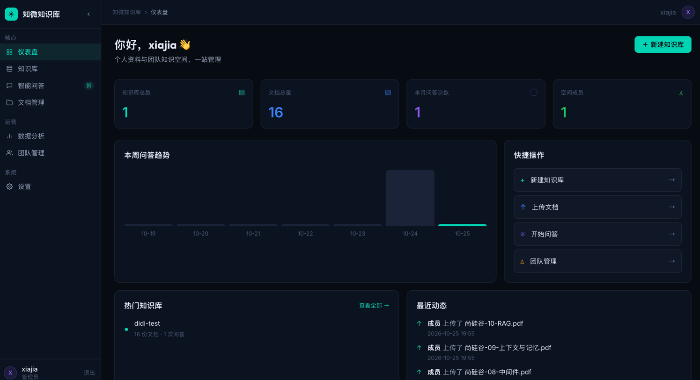
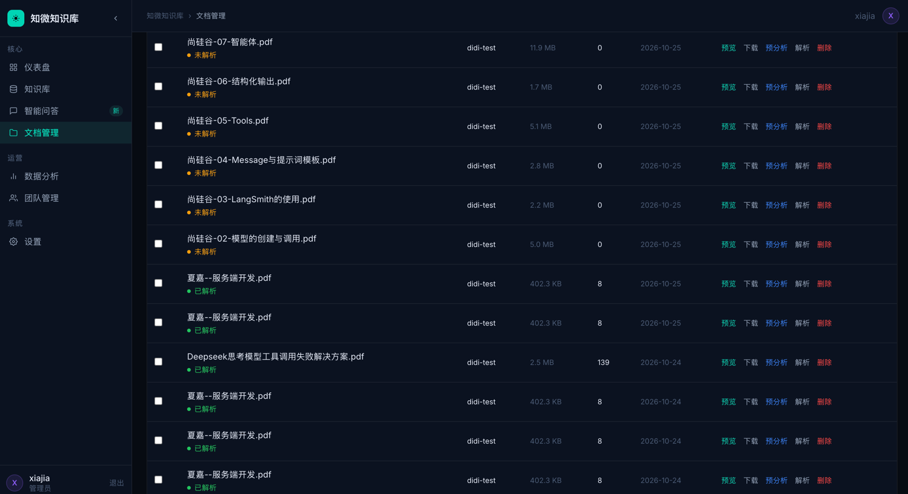
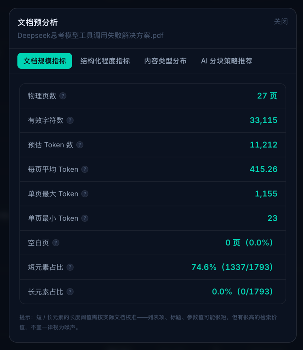
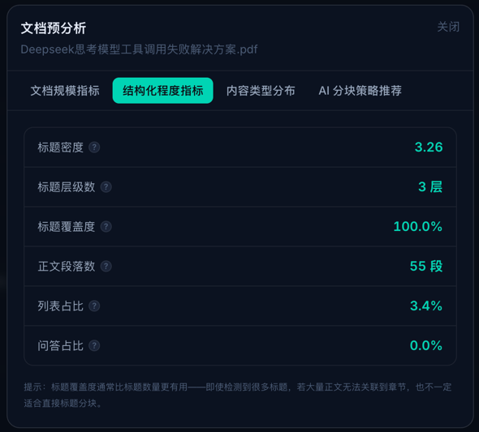
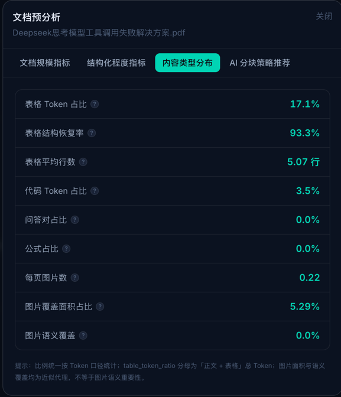
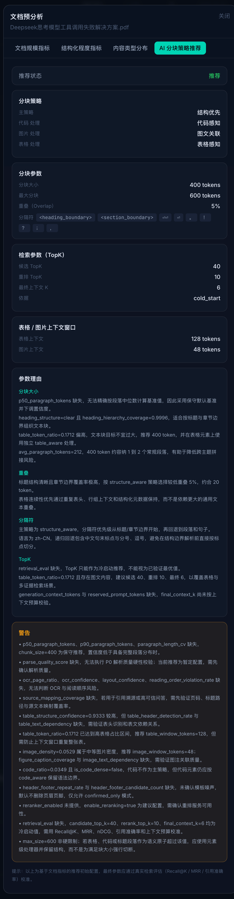

# 个人与团队知识库

面向个人与团队的多知识库 RAG 问答系统：**React 前端 + Flask 后端**，支持多知识库隔离、云端 Embedding 语义检索、多用户登录、流式问答。

## 功能特性

- **多知识库**：按业务场景拆分（合同 / 财务 / 产品手册 / 售后话术 / 政策…），各库独立上传文档、独立检索问答。
- **语义检索**：Embedding 向量保存在 Elasticsearch，通过 kNN 检索；MySQL 继续保存用户、知识库、文档、会话等业务数据。
- **团队多租户**：用户、知识库、文档和会话按租户隔离；知识库可设为团队共享或指定成员访问。
- **团队权限**：管理员、编辑、只读三种团队角色；管理员可以为每个知识库再指定编辑/只读成员。
- **产品工作台**：仪表盘、知识库向导、智能问答、文档管理、数据分析、团队管理和设置均接入后端数据。
- **多用户登录**：bcrypt + JWT，首个注册用户自动成为管理员；团队邀请生成初始密码，当前版本尚未接入邮件投递。
- **流式问答**：SSE 流式输出，回答附带来源文档与相关度分数。
- **解析方式可选**：上传时可选纯文本解析（原方式）、DeepDoc 深度解析（版面 + OCR + 表格，即将上线）、或仅上传不解析。
- **文档预分析**：对每份文档提供四类指标分析（文档规模 / 结构化程度 / 内容类型分布 / AI 分块策略推荐），结果缓存到数据库，二次进入秒开。
- **数据隔离**：业务记录始终按 `tenant_id` 查询；MySQL 可用于远程部署，上传文件保存在应用服务器的租户独立目录。

## 功能展示

### 1. 仪表盘



知识库总数、文档总量、本月问答次数、空间成员等关键指标一览，附本周问答趋势、热门知识库与最近动态。

### 2. 文档管理



文档列表支持预览、下载、预分析、解析、删除，并展示每份文档的解析状态（已解析 / 未解析）。

### 3. 文档预分析 · 文档规模指标



物理页数、有效字符数、预估 Token、每页平均 / 最大 / 最小 Token、空白页、短 / 长元素占比——一眼判断文档规模与信息密度。

### 4. 文档预分析 · 结构化程度指标



标题密度、标题层级数、标题覆盖度、段落数、列表占比、问答占比——判断文档是否适合标题分块。

### 5. 文档预分析 · 内容类型分布



表格 / 代码 / 问答 / 公式 Token 占比、表格结构恢复率、每页图片数、图片覆盖与语义覆盖——识别文档内容构成。

### 6. 文档预分析 · AI 分块策略推荐



基于评估 skill + DeepSeek，自动推荐分块大小、重叠、分隔符、分块策略与检索 TopK，并给出每条参数的理由与警告。

## 技术栈

| 层 | 技术 |
|---|---|
| 后端 | Python 3.11 · Flask · SQLAlchemy（MySQL / SQLite）· PyMuPDF（解析与指标）· numpy · DeepSeek（问答 + AI 分块推荐）· 云端 Embedding（检索） |
| 前端 | React 18 · TypeScript · Vite · Tailwind CSS 4 · react-router · react-markdown |

## 目录结构

```
RAG/
├── backend/          # Python + Flask 后端
│   ├── app.py        # Flask 应用工厂、错误处理、Blueprint 注册
│   ├── core/         # 环境配置、数据库访问与请求校验
│   │   ├── config.py
│   │   ├── db.py
│   │   └── schemas.py
│   ├── controllers/  # 按业务域拆分的 HTTP 控制器
│   ├── services/     # 文档入库、聊天等业务编排
│   ├── repositories/ # 数据持久化访问
│   ├── models/       # SQLAlchemy 数据模型
│   ├── rag/          # parsing、analysis、recommend、embeddings、vector_store、generation、llm
│   │   ├── parse_method/  # DeepDoc 深度解析（DLA / OCR / TSR，Python 移植）
│   │   ├── parse_model/   # DeepDoc 模型权重（det / rec / layout / tsr / ocr.res）
│   │   └── parse_skill/   # AI 分块推荐评估 skill
│   ├── security/     # 认证与授权
│   ├── ops/          # MySQL 初始化等运维命令
│   ├── main.py       # Flask 本地开发入口
│   ├── requirements.txt
│   └── data/         # SQLite、上传文件和 JWT 密钥
├── frontend/         # React + TypeScript 前端（Vite）
│   ├── src/workspace-pages/ # 产品工作台页面
├── .env              # 本地服务配置
└── README.md
```

## 快速开始

### 1. 安装后端依赖

```bash
pip install -r backend/requirements.txt
```

前端构建要求 Node.js 20.19 或更新版本；服务器建议使用 Node.js 20 LTS。

### 2. 配置 `.env`

```env
# 问答模型（DeepSeek，OpenAI 兼容协议）
DEEPSEEK_API_KEY=sk-xxx
DEEPSEEK_MODEL=deepseek-chat

# 检索向量（DeepSeek 无 embedding 接口，需另配供应商）
EMBEDDING_BASE_URL=https://api.siliconflow.cn/v1
EMBEDDING_API_KEY=sk-xxx
EMBEDDING_MODEL=BAAI/bge-m3

# 向量索引（文本切片与 embedding 都保存在 Elasticsearch）
ELASTICSEARCH_URL=http://127.0.0.1:9200
ELASTICSEARCH_INDEX=personal-rag-chunks
# 云 ES 可使用 API Key，或使用用户名密码（二选一）
ELASTICSEARCH_API_KEY=
ELASTICSEARCH_USERNAME=
ELASTICSEARCH_PASSWORD=
ELASTICSEARCH_VERIFY_CERTS=true

# DeepDoc 深度解析（版面分析 + OCR + 表格结构；需 onnxruntime/opencv/pyclipper/PyMuPDF + 模型权重）
DEEP_DOC_MODEL_DIR=backend/rag/parse_model
DEEP_DOC_ENABLED=false

# JWT 密钥（留空则自动生成并持久化到 backend/data/.jwt_secret）
JWT_SECRET=

# 服务端口
PORT=8000
```

**Embedding 供应商**：默认推荐 [硅基流动 SiliconFlow](https://siliconflow.cn) 的 `BAAI/bge-m3`（便宜、中文好、注册送额度）。任意 OpenAI 兼容的 embedding 服务均可，改 `EMBEDDING_BASE_URL` / `EMBEDDING_MODEL` / `EMBEDDING_API_KEY` 即可，代码零改动。备选：智谱 `embedding-3`、阿里 `text-embedding-v3`。

### 3. 启动后端

```bash
python backend/main.py  # 本地开发服务器，同时服务 API 与前端产物
# 生产环境：
gunicorn --chdir backend --workers 2 --bind 127.0.0.1:8000 app:app
```

Flask 应用使用工厂 `create_app()` 创建，并通过按业务域划分的 Blueprint 注册 API。生产环境请由 Gunicorn 托管，再由 Nginx 反向代理；不要将 Flask 开发服务器用于生产。

### 后端分层

| 层 | 位置 | 职责 |
|---|---|---|
| Model | `backend/models/` | SQLAlchemy 实体定义，保持现有表结构 |
| Controller | `backend/controllers/` | Flask Blueprint 路由、HTTP 参数/响应和认证入口 |
| Service | `backend/services/` | 文档入库补偿、聊天会话与 RAG 流程编排 |
| Repository | `backend/repositories/` | 文档、会话和消息的数据库访问 |
| RAG | `backend/rag/` | 文档解析、Embedding、向量检索、提示词组装和模型调用 |

控制器按业务域拆分，原 API 路径、Bearer JWT 认证及响应字段保持兼容。项目尚未实现知识蒸馏、重排序或多源连接器，不为这些能力预建目录。

MySQL 初始化和历史租户迁移 SQL 已集中在 `backend/data/mysql/mysql_all.sql`。新部署只需执行文件中的“新库初始化”部分；已经完成租户迁移的现有数据库无需重跑历史迁移部分。执行前，将初始化部分两处 `REPLACE_WITH_A_LONG_RANDOM_PASSWORD` 换成同一个强密码。然后把以下设置追加到项目根目录 `.env`，并填同一应用密码和服务器提供的可信 CA PEM 路径：

文档切片及向量在 Elasticsearch 中，使用 ES 8.x 或兼容版本。首次写入时系统会按当前 embedding 模型的输出维度自动创建索引；切换到不同维度的 embedding 模型时，应换一个 `ELASTICSEARCH_INDEX` 并重新索引文档。

运行 MySQL 初始化工具：

```bash
cd backend && python -m ops.provision_mysql
```

```env
DATABASE_BACKEND=mysql
MYSQL_HOST=123.57.80.38
MYSQL_PORT=3306
MYSQL_DATABASE=rag_db
MYSQL_USER=rag_app
MYSQL_PASSWORD=替换为你设置的应用密码
MYSQL_SSL=true
MYSQL_SSL_VERIFY=true
MYSQL_SSL_CA=/path/to/mysql-ca.pem
```

应用账号要求 TLS；建议将 SQL 中的 `'rag_app'@'%'` 限制为后端服务器的固定来源 IP。

#### 从 MySQL chunks 迁移到 Elasticsearch

部署新版前先备份数据库，并在 `.env` 中同时配置现有 MySQL 和 Elasticsearch。切换代码后执行：

```bash
cd backend
pip install -r requirements.txt
python -m ops.migrate_chunks_to_es
```

迁移脚本可重复运行，会按原切片 ID 幂等写入 ES；旧数据库中没有 embedding 的切片会用当前模型重新生成。确认 ES 数据和检索正常后，如需从 MySQL 删除旧 `chunks` 表，再执行 `python -m ops.migrate_chunks_to_es --drop-mysql-chunks`。新安装的 MySQL schema 不再创建该表。

### 4. 前端（开发 / 构建）

```bash
cd frontend
npm install
npm run dev            # 开发：http://localhost:5173（自动代理 /api 到 8000）
npm run build          # 构建到 frontend/dist，由后端静态托管
```

构建后直接访问 `http://localhost:8000` 即为完整应用（前端 + API 同源）。

## 使用流程

1. 打开应用 → 注册首个账号（自动成为**管理员**）。
2. 管理员新建知识库（如「员工手册」）。
3. 在「文档管理」中上传 PDF / Word / txt / md 等文档（可选解析方式，自动解析、分块、向量化）。
4. 对文档点击「预分析」查看四类指标，并可生成 AI 分块策略推荐。
5. 在知识库内直接提问，回答会附带来源文档与相关度。
6. 管理员在「用户管理」中为员工创建账号（角色：成员）。

## 文档预分析

文档管理页对每份文档提供「预分析」面板，分四类：

| 分类 | 说明 |
|---|---|
| 文档规模指标 | 物理页数、有效字符数、预估 Token、每页平均/最大/最小 Token、空白页、短/长元素占比 |
| 结构化程度指标 | 标题密度、标题层级数、标题覆盖度、正文段落数、列表占比、问答占比 |
| 内容类型分布 | 表格/代码/问答/公式 Token 占比、表格结构恢复率、每页图片数、图片覆盖与语义覆盖 |
| AI 分块策略推荐 | 基于 `rag/parse_skill/ai_recommend_skill.md` 评估 skill，由 DeepSeek 生成 chunk size / overlap / separators / 分块策略 / TopK / 表格图片上下文窗口等推荐 |

四类分析结果缓存到 `document_analyses` 表（按租户 + 文档 + 分类唯一定位）：首次计算后写入数据库，再次进入直接读缓存；重新解析文档会清除该文档的缓存。

## 权限模型

| 角色 | 权限 |
|---|---|
| 管理员 admin | 管理知识库、文档、用户；删除任意会话 |
| 编辑 operator | 访问团队共享或已授权知识库、上传文档、管理自己的会话 |
| 只读 user | 访问团队共享或已授权知识库并问答，不能上传文档 |

知识库默认团队内共享。管理员可在知识库详情中切换为指定成员访问，并分别授予编辑或只读权限。会话按用户隔离。

## 常见问题

- **上传报「EMBEDDING_API_KEY 未配置」**：`.env` 中未填向量供应商的 key（DeepSeek 不提供 embedding）。
- **想换检索供应商**：改 `.env` 里 `EMBEDDING_*` 三项即可；换成不同向量维度的模型时，配置新的 `ELASTICSEARCH_INDEX` 并重新上传或迁移文档以重建向量。
- **端口**：生产可改回 80（需 root）；本地开发建议 8000。
